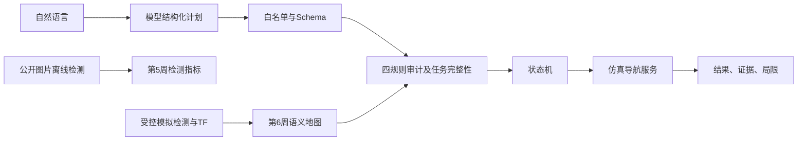

# 第1周：环境、架构与接口契约

状态：VM与仿真接口已盘点；原课程硬件契约未全满足。原始证据：[环境](../../evidence/raw/week1_environment.json)、[ROS现场快照](../../evidence/raw/week1_live_sim_v3.json)。频率来自约5秒窗口，不能推为长时稳定性。

| 接口 | 类型 / 坐标系 | 当前证据与约束 |
|---|---|---|
| /cmd_vel | geometry_msgs/msg/Twist；m/s、rad/s | 速度执行入口；软件零速不等于实车制动证明 |
| /odom | nav_msgs/msg/Odometry；odom | 51条、约10Hz、51个不同时间戳；不是硬件50Hz通过 |
| /scan | sensor_msgs/msg/LaserScan；laser_frame | 50条、约10Hz；模拟雷达。旧快照和当前720束改进实验须分版本 |
| /imu | 未发现 | 缺项，不能用示例代码补成实测 |
| /map | nav_msgs/msg/OccupancyGrid；map | 静态发布不要求10Hz；未知格保留，不能当自由区 |
| /navigate_to | 项目ROS服务 | 60秒预算，SUCCEEDED/FAILED/TIMEOUT；详见第4周 |
| /agent/instruction、/agent/plan_events | std_msgs/msg/String | 第8周指令与plan/audit/exec/report事件 |

实测TF：map→odom→base_footprint；base_footprint→base_link、laser_frame。快照中激光高度0.5m是仿真设置，不能拿来当实车外参。

公开图片的坐标没有直接接入世界地图。新增第6周域50消息链路见[第6周](week06.md)，与47/49导航域分开。

复核：在仿真运行时使用 `scripts/collect_sim_evidence.py --help` 按当前支持参数采集新目录；先检查时间戳、发布者和坐标系，再解释频率。后续需补真实固件话题盘点、长时掉线与时钟检查；没有传感器的接口保留缺项。
