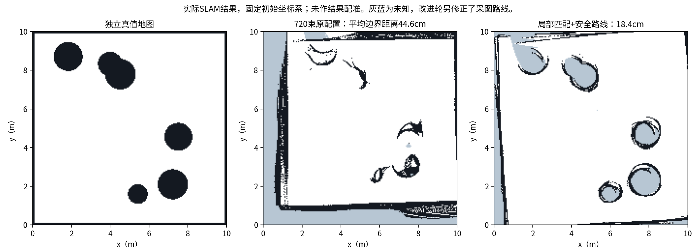

# SLAM质量改进与验证边界

本轮保留全部失败试验，在720束、5%打滑条件下收紧局部匹配搜索；相同旧路线的平均边界距离由44.6cm降到18.6cm。修正采图路线后复测为18.4cm，已知覆盖率约90.4%。

仍未全部验收通过：安全路线终点SLAM位置误差约36.8cm，估计边界到真值的95%分位距离约50cm；不能称为厘米级建图或直接给实车导航放行。

|探索条件|已知覆盖率|估计边界→真值均距|95%距离|
|---|---:|---:|---:|
|360束基线|74.2%|57.0cm|160.0cm|
|排除最大量程伪点|83.5%|46.5cm|105.0cm|
|保守匹配探索|79.8%|49.6cm|160.0cm|
|720束基线|85.7%|44.6cm|105.0cm|
|局部匹配，同旧路线|90.5%|18.6cm|50.2cm|
|局部匹配，安全路线|90.4%|18.4cm|50.0cm|

## 改动与依据

1. 模拟5m读数代表无命中；Karto匹配端点范围包含阈值端点。将匹配量程设为4.9m，排除饱和读数，仍保留原始5m雷达消息。
2. 按Karto安装源码的角分辨率/栅格覆盖建议，测试360与720束解析模拟雷达；720束为0.5°，不是插值24束。所有条件明确标记，未冒充真实雷达。
3. 局部匹配窗口收紧到0.2m，角搜索±0.1rad，调整里程计先验；使用传感器位姿参考，关闭本短程诊断中的回环约束。它是一组工程改动，不作单因素因果结论，也不证明搬运后重定位。
4. 发现旧路线车体与底部障碍有重叠；保留旧探索记录，另用安全路线复测，并加入0.1m实时净空保护。

安全路线记录的最小车体净空为25.7cm，车体重叠0次，模拟终止事件0次。改了路线，因此新安全路线与旧路线不能作纯参数单因素对照。

## 证据与使用

原始运行：`evidence/raw/week3_slam/20261026T030832Z`。含原始scan/odom/TF/map ROS包、地图两件套、参数、初始/最终快照和真值摆放轨迹。原始包已校验SQLite完整性，并从消息确认720束。
评分固定使用移动前的map→odom标定，未为提高指标拟合最终地图。旧局部匹配实验的一份初始快照曾在未成功重启时复用文件名；已保留该错误快照，并从原始ROS包首条map→odom恢复初始标定，与先前评分记录相同。现在采集器禁止覆盖已有快照。

导出地图：`outputs/slam_improvement/map_slam.pgm`与`map_slam.yaml`，PGM原样复制；导出YAML的free_thresh为0.196，以使205灰度未知像素重载时保持未知，几何参数未变。原始地图不修改。
改进参数在 `config/mapper_sim_improved.yaml`；启动用 `bash scripts/run_slam_improved.sh`。另一个ROS域48终端用 `run_mapping_route.py --route-file config/mapping_route_safe_v2.json --output 新运行目录/mapping_route.json` 采图。

仿真真值只用于摆放/净空保护和独立评分，没有作为map→odom注入SLAM；改进图来自slam_toolbox实际扫描匹配。720束模拟传感器结果不能证明原24束或实际ESP32硬件能力。

## 文件整理记录

历史旧路线的大型原始包现为 `evidence/raw/week3_slam/20261026T025521Z/rosbag.tar.gz`，所有成员已按SHA256校验；需要读取时在同目录解压。最终安全路线的ROS包仍直接可读。早期探索指标移至 `archive/exploration_reports/`。
