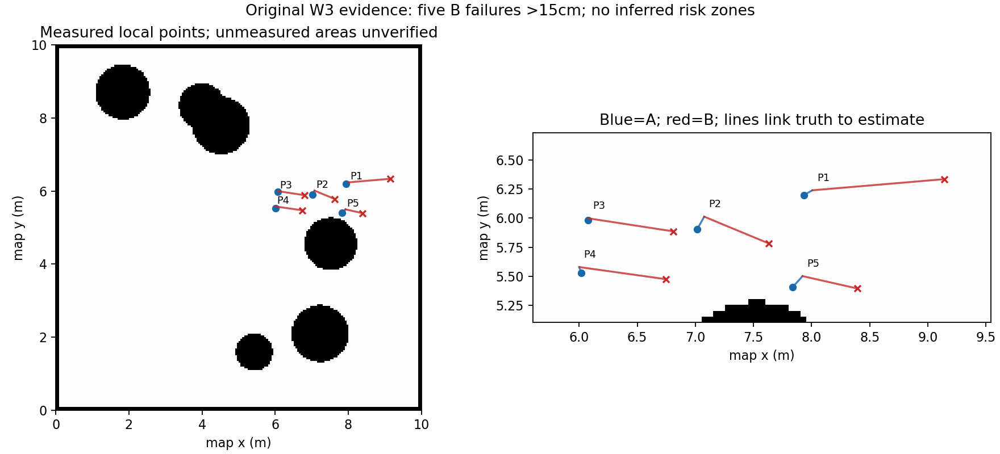

# 第3周定位统计与不可信点证据

本页复算原24束、已知地图条件下的10格AMCL采样，不是新增定位实验，也不替代720束SLAM图验证。

[原始CSV](../raw/week3_localization_selected.csv) · [证据JSON](week3_evidence_linked_points.json)

| 证据号 | 条件 | 位置误差cm | 偏角° | 主轴1σ标准差界cm | B结果 |
|---|---|---:|---:|---|---|
| W3_P1_A | A | 8.45 | 0.67 | 23.5–30.1 | not_applicable |
| W3_P1_B | B | 114.06 | 40.37 | 19.5–21.6 | not_converged_within_30s |
| W3_P2_A | A | 12.34 | -0.44 | 21.8–30.3 | not_applicable |
| W3_P2_B | B | 60.29 | 7.38 | 31.5–36.5 | not_converged_within_30s |
| W3_P3_A | A | 1.50 | -0.11 | 22.3–31.2 | not_applicable |
| W3_P3_B | B | 74.14 | -1.35 | 10.2–10.4 | not_converged_within_30s |
| W3_P4_A | A | 5.46 | 0.56 | 23.3–31.0 | not_applicable |
| W3_P4_B | B | 75.09 | -0.31 | 16.7–19.7 | not_converged_within_30s |
| W3_P5_A | A | 12.99 | -1.01 | 19.3–26.7 | not_applicable |
| W3_P5_B | B | 48.50 | 6.85 | 20.3–23.9 | not_converged_within_30s |

条件A：5格平均误差8.15cm，最大12.99cm。

条件B：5格平均误差74.42cm，最大114.06cm。

按原预注册15cm不可信阈值，5个B条件均不可信；A均未超过阈值。图只标实际测量点及估计连线，不画无数据支持的连续风险区或半径。B在30秒内未收敛，不足以单独判定“发散”或“高置信锁定”。

只保存了cov_x/cov_y，没有cov_xy；因此只能给出主轴1σ标准差的上下界，不能还原精确协方差椭圆，也不能补写课程要求的rviz目视小/中/大等级。标准差不是定位真值误差，数值小不保证准确。

原试验只覆盖局部、使用24束及已知地图，不能直接作为当前720束SLAM图的空间拒绝区。若第8周需要自动拒绝不可信区域，须先补当前配置下的点位实验及明确的区域/条件策略，不能任意给5个点扩成整片禁区。教师/同学地图互评和实车签字仍待外部材料，未伪造。
