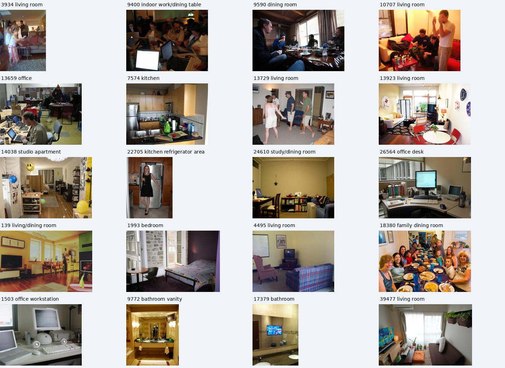
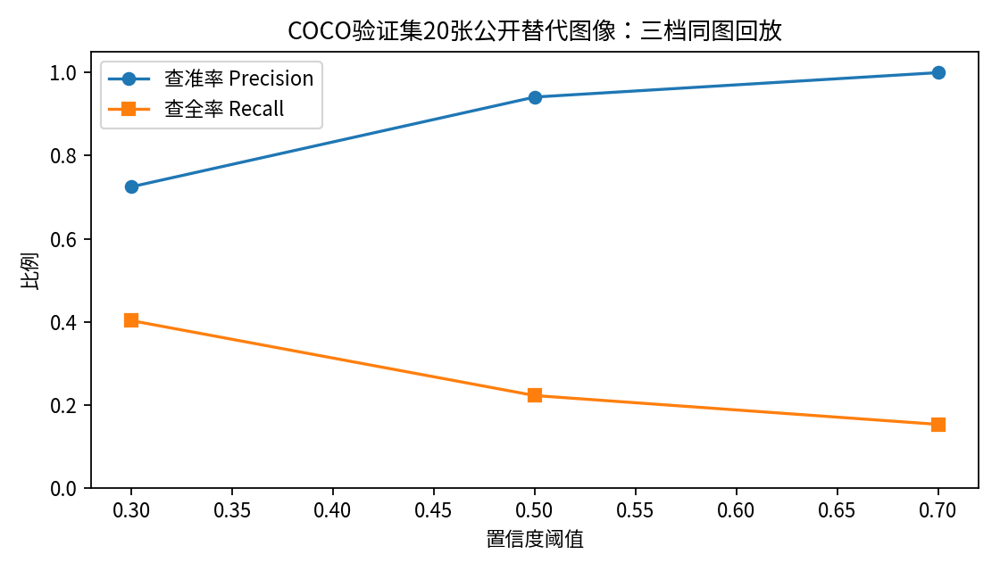

# 第5周：20张室内公开场景替代实验

用户指出原版含棕熊和非场景图，已按室内场景重新选图。当前数据为 `data/coco_indoor20_v2/images/`，原版保留但不再作为当前场景评测集。

先按COCO标注筛候选，再人工检查完整场景，排除动物/户外照片及孤立物品特写；选定并冻结20张后才运行新版检测。全部是公开验证图，没有标成自采图。

共有20场景、72个目标：{'cup': 31, 'bottle': 15, 'chair': 26}。其中4张不含所评估三类目标的室内负样本。

|阈值|TP|FP|FN|Precision|Recall|
|---:|---:|---:|---:|---:|---:|
|0.3|29|11|43|72.5%|40.3%|
|0.5|16|1|56|94.1%|22.2%|
|0.7|11|0|61|100.0%|15.3%|

候选语义登记阈值选0.5：误报由11降到1，Precision为94.1%，但Recall仅22.2%，仍需人工复核和补充观测，不能称为完整可靠的环境感知。该选择依据本组20场景结果，后续独立数据须再验证。

模型为官方YOLOv5n ONNX，640×640静态输入；统一letterbox缩放，框回到原图像素空间。NMS IoU固定0.45，评估同类IoU≥0.5，一对一匹配；3档使用同一组原图，不重拍。

原始标注和选图理由：`data/coco_indoor20_v2/dataset.json`。模型输出：`evidence/raw/week5_indoor20_v2_predictions.json`。逐图×阈值60次计数：`evidence/reports/week5_indoor20_v2_metrics.json`。逐图框图在 `outputs/week5_indoor20_v2/`，绿框为COCO真值，红框为检测结果。

来源：COCO2017 validation及其官方标注；模型来自Ultralytics官方v7.0发布。图片原始URL、Flickr地址、许可编号和文件SHA256均保存在清单中。

这是用户授权的公开数据替代实验，不等同教师公共10+自采10；没有车载相机标定、ROS相机部署或实车视觉通过的结论。640输入也不等同课程320输入部署。通用旧版30秒VM模型吞吐约10.25FPS，仅为辅助模型计时，不是摄像头帧率。

## 候选阈值0.5的分类明细

|类别|TP|FP|FN|Precision|Recall|
|---|---:|---:|---:|---:|---:|
|cup|5|1|26|83.3%|16.1%|
|bottle|2|0|13|100.0%|13.3%|
|chair|9|0|17|100.0%|34.6%|
