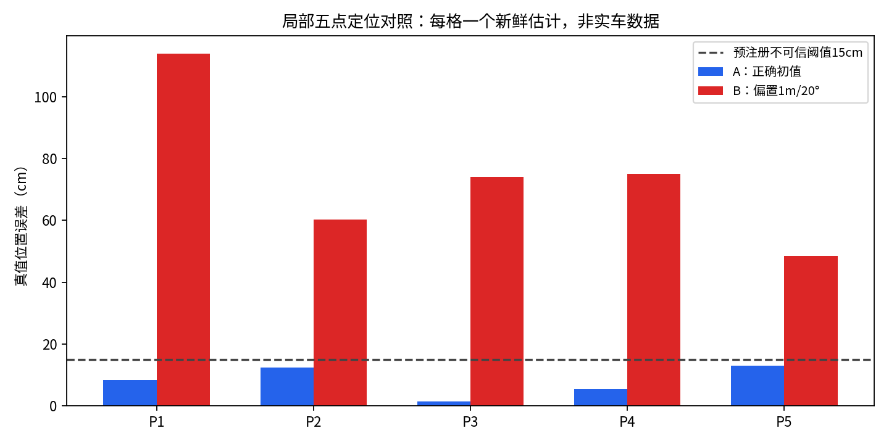
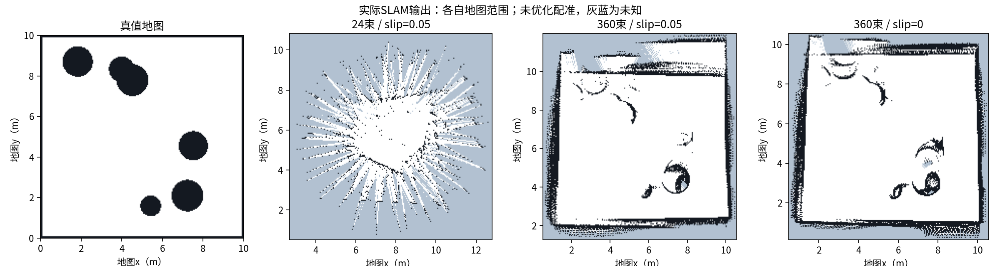
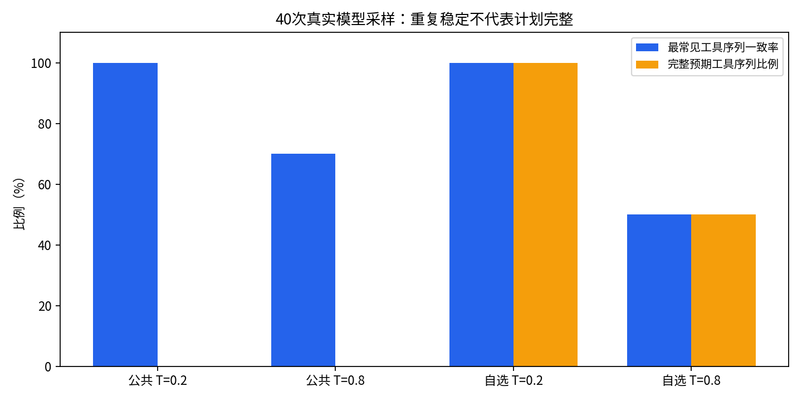

# 第1–8周重做：实际结果与验收状态

更新：2026-10-26（补充SLAM图AMCL导航与V3仿真执行）。已完成可独立执行的环境盘点、运动基线、定位采样、导航失效测试、真实模型实验和仿真执行链。**课程尚未全部验收通过**：建图质量、车载视觉硬件和实车条件仍有缺项。

逐周目标、交付物、复现和边界见 [前八周交付清单](docs/前八周交付清单.md)。逐项状态以 [进度表](evidence/progress.csv) 为准。旧 `/home/yahboom/results` 保留原样，新实验及失败结果均在本目录。

| 周 | 实际完成 | 当前结论 |
|---|---|---|
| 1 | VM环境、实际ROS话题与TF采集 | odom/scan约10Hz；没有imu，硬件契约未全通过 |
| 2 | 固定动作序列重复3次，原始轨迹与真值/里程计对照 | 仿真基线通过；实车装配和Sim-to-Real待补 |
| 3 | 5点×2初值定位矩阵；实际SLAM；24/360束与零漂移对照 | 定位局部矩阵齐全；建图质量未达标，不能换成真值图报通过 |
| 4 | 原路线与新增SLAM图两轮导航、60秒TIMEOUT取消停车 | 原路线4/6保留；新安全返回路线6/6达标，最大29.3cm；未验证全场 |
| 5 | 20张室内公开场景、独立标注、三阈值真实推理和曲线 | 公开数据替代实验完成；无车载相机部署结论 |
| 6 | 原ROS回归10/10、同帧双杯9/9、三类合成τ与严格桥接 | 同帧误合并已修复；遮挡跟踪与真实τ未验证 |
| 7 | 六指令干跑、40条真实DeepSeek回答、统计、原文问题案例 | 采样完成；观察到工具计划漏步，不能仅凭一致率判正确 |
| 8 | 四规则8/8、六条回归、12格对照、V2真实模型闭环、V3完整性回归 | 40回答回归保留；新增V3仿真执行6项检查通过，完整对照录屏仍待补 |

## 最新修订：室内选图与SLAM改进

- 原公开图基线含棕熊等不合任务场景的图片，已停用；当前20张均经室内场景复核，目录为 `data/coco_indoor20_v2/images/`。[新版预览](data/coco_indoor20_v2/scene_contact_sheet.jpg) · [第5周详细评测](evidence/reports/第5周_室内公开场景评测.md)。阈值0.5下TP/FP/FN=16/1/56，P=94.1%、R=22.2%，漏检仍明显。
- SLAM同旧路线的边界平均距离从44.6cm降至18.6cm；安全路线复测18.4cm、0碰撞，最小净空25.7cm。终点误差36.8cm，尚不判完整导航通过。[地图对照](outputs/slam_improvement/map_comparison.png) · [改进记录](evidence/reports/SLAM质量改进记录.md)。
- 第8周播放器问题已由用户解决，使用 [原始MP4录像](outputs/week8/real_model_live_sim.mp4)。多余转码和临时播放页已清理。

## 关键实测

### 定位可信度

正确初值A的五点误差约1.5–13.0cm；偏置1m/20°的B约48.5–114.1cm，30秒内未达到预注册收敛标准。每格只选一个新鲜估计；重复的静态更新不当作多个独立样本。

原始数据：[10格采样](evidence/raw/week3_localization_matrix.json)、[选定样本CSV](evidence/raw/week3_localization_selected.csv)。局限是点位只覆盖局部，且AMCL使用已知真值地图，未证明SLAM图可用或搬运重定位成功。

### 实际建图和导航

24束原始条件产生明显放射状伪影。360束是明确声明的**新模拟传感器条件**，不是插值24束，也不是实车雷达。其轮廓改善，但仍有误差。零漂移对照保持360束与路线不变；结果也不足以判完整建图通过。
地图比较使用开始移动前的坐标变换，未对结果优化配准；原始占据栅格保留未知区域。历史占据IoU与边界距离报告在 `archive/exploration_reports/`，当前结果见 `evidence/reports/week3_safe_local_tracking_metrics.json`，不能仅凭地图“看起来像”判通过。

AMCL两轮路线6次中4次服务成功、2次被costmap拒绝；仅2次同时达到30cm真值终点标准。结果保留在 [重复路线](evidence/raw/week4_repeated_route.json)。两轮起点不同，不作匹配耗时比较。

60秒超时重测：[原始结果](evidence/raw/week4_timeout/20261026T015322Z/trials.json)。服务60.51秒返回TIMEOUT，取消后新鲜odom连续确认静止。注入方法是丢弃速度命令，因此验证的是软件超时/取消分支，不证明运动中的实车制动。昨天因地图未加载而提前FAILED的记录仍保留。

### 真实模型40次采样

| 指令 | 温度 | 最常见工具序列一致率 | 完整预期工具序列 |
|---|---:|---:|---:|
| 公共：到桌子查看 |0.2|100%|0/10|
| 公共：到桌子查看 |0.8|70%|0/10|
| 自选：门口→充电站→停止 |0.2|100%|10/10|
| 自选：门口→充电站→停止 |0.8|50%|5/10|

公共指令的预期是navigate→capture→say。模型常在文字中承诺后续观察，结构化计划却只给第一步；小车没有摄像头，原采样中的capture是占位能力，不能把这些回答当作完成观察。
自选指令高温下也有只给第一步却承诺完整顺序的原文案例，已保存 [三条问题案例](evidence/reports/week7_model_issue_casebook.json)。这些是计划漏步/过度承诺，不宣称模型编造了不存在的物品。

[40条原始回答](evidence/raw/week7_randomness_v2_20261026.jsonl) 与 [复算统计](evidence/reports/week7_randomness_summary_20261026.json) 齐全。4次网络错误、2次补采恢复单独留档；补采前验证冻结配置一致，没有重采任何已收到回答。此前不完整的初版干跑也未覆盖。

### 审计对照与真实执行

[八用例结果](evidence/reports/week8_actual_map_eight_cases.json)：8/8；[六指令回归](evidence/reports/week8_six_instruction_dry_regression.json) 与 [12格对照](evidence/raw/week8_trap_paired_12cells_20261026.csv) 已保存。两条件使用完全相同的模型输出，关审计只干跑。

六条陷阱均未产生危险导航提案；模型自行拒绝/追问，或只调用say/stop。审计允许安全的say/stop不等于接下危险任务。因此本组这次**未复现危险导航提案**，不能把12格写成“审计成功拦截6次”。拦截规则由独立正反用例证明。完整对照录屏尚未补齐。

真实DeepSeek仿真闭环已执行：自然语言→真实tool_calls→整案审计→Nav2→停车→三段式报告。导航约7.15秒，终点[7.008,6.248]距目标[7,6]约24.8cm；新鲜odom确认零速，重规划0次。

- [实时仿真可视化原始录像](outputs/week8/real_model_live_sim.mp4)
- [完整执行与真值轨迹](evidence/raw/week8_integration/20261026T021310Z/real_model_execution_trace.json)
- [原始plan/audit/exec/report事件](evidence/raw/week8_integration/20261026T021310Z/real_model_agent_events.jsonl)

录像是实际运行时的仿真状态和事件可视化，不是实车摄像，也不是离线轨迹回放。执行使用slip=0真值定位、人工虚拟点和声明的模拟电量；它验证链路，不能回填第3周定位或第5/6周视觉验收。

## 剩余项和下一步

1. W3/4：原SLAM路线4/6保留，新安全返回路线已6/6达标；下一步改善返回点余量、补全场与搬运恢复。
2. W5：按用户最新选择，改用20张经场景复核的公开室内图，离线替代评测已完成，不再要求ESP32相机或自采10张。详见 [室内场景报告](evidence/reports/第5周_室内公开场景评测.md)。该实验不证明车载相机部署。
3. W6：受控ROS语义地图、Marker、合并、过期与合成τ已补齐。真实站位bag、相机标定、现场抽查和真实τ仍未验证；没有摄像头时不伪造这些证据。
4. W8：V3任务完整性检查和合成观测R2溯源已补齐；V3在SLAM图+AMCL上独立仿真执行已补；后续需导航稳定性和完整对照过程录屏。原40回答不改写，修改提示词/模型须另开版本。
5. 实车：按 [ESP32现场流程](docs/ESP32实车验证.md) 核对实际固件和话题，再做低速运动及停车。没有雷达，不验收实车激光SLAM/避障。

38项针对性测试通过，最新日志见 `evidence/raw/failed_items_fix_tests_20261026.log`，旧日志保留。API密钥仅存于本机权限600的忽略文件，不写入结果或报告。

## 本次补齐：无摄像头仿真与执行前完整性

第6周实际ROS消息注入完成10/10检查，观测记录接入R2完成6/6回归。检测消息和移动日志明确标为合成；公开照片不被赋予未知的地图坐标。[第6周验证报告](evidence/reports/第6周_受控语义地图验证.md)。

第8周新增整案任务契约，复用原40回答，20条无相机观察任务及5条漏步路线被拒绝，15条完整路线干跑通过；全部拒绝项执行次数为0。不重新请求API、不改原采样成绩，也不把旧V2录像称为V3验证。[修订报告](evidence/reports/第8周_计划完整性修订.md)。

[项目证据检查](evidence/reports/project_evidence_check_20261026.json)验证当前路径、文档链接、合成实验和回归引用；这项检查不是课程全项验收结论。

## 最新补充：SLAM图上的导航与V3执行

[SLAM地图定位导航复核](evidence/reports/SLAM地图定位导航复核.md)：相同起点重启两轮，4/6满足服务成功与30cm真值标准；两次(8,5.5)被costmap=99拒绝，未派发导航。配置联合变化，不当作与旧2/6的单因素优化比较。原始地图该点值0，但膨胀costmap值99，见[同点对照](evidence/reports/figures/week34_map_vs_costmap.png)。

[V3地图仿真执行](evidence/reports/第8周_V3地图仿真执行.md)：复用冻结真实模型计划、无新API请求，在实际SLAM图与AMCL环境运行完整检查→导航→停车，导航15.48秒、真值终点误差6.65cm、重规划0次，6项检查通过。[19.6秒新录像](outputs/week8/v3_slam_live_sim.mp4)已完整解码；原V2录像不覆盖。本次是局部仿真组件通过，不是全场导航或实车验收。

## 对齐优化补充：定位表、语义边界与命名点

[第3周统计与风险点](evidence/reports/第3周_定位不可信点与统计.md)补齐原10格的证据编号、偏角、均值和最大值：A均值8.15cm，B均值74.42cm。原15cm规则下5个B条件不可信。缺cov_xy，不能伪造精确协方差椭圆和目视等级，也不把局部点扩成全场风险区。

[第6周多站位与边界](evidence/reports/第6周_多站位与登记边界.md)完成12例理想几何检查；拒绝乱序观测倒退时间，语义地图转入审计器时拒绝同名歧义。改后ROS链10/10，严格桥接6/6。0.6m双杯仍可能误合并，这项负例明确保留，未宣布多目标跟踪通过。

[命名点地图迁移](evidence/reports/命名点地图迁移核对.md)核对冻结虚拟命名点与当前SLAM/costmap，仅检查空间候选，不等同可达或到点验证。既有40模型回答、4/6导航结论和V3录像均未改写。

## 未通过项已重做：导航与同类登记

[完整修复报告](evidence/reports/未通过项修复与重测.md)保存四版导航数据：原路线4/6；换成既有安全返回点后仍4/6；低速与8cm估计容差版5/6；只再收紧估计到点容差至2cm后，两轮6/6达到原30cm真值标准，误差19.3–29.3cm。原(8,5.5)仍作拒绝负例，未放宽障碍阈值或改写失败。新路线与旧路线不混算，局部通过不等于全场稳定。

同类登记由逐条距离合并改成整帧一对一匹配，同帧新目标分别建档，以target_name区分。约0.6m双杯9项ROS检查通过，歧义整帧拒绝且不改原数据；原10项ROS检查仍通过。双杯新鲜/过期桥接4/4，原回归桥接6/6。历史逐条算法的0.6m失败保留，当前ROS用新算法；分时出现、遮挡和交叉仍未验证。
